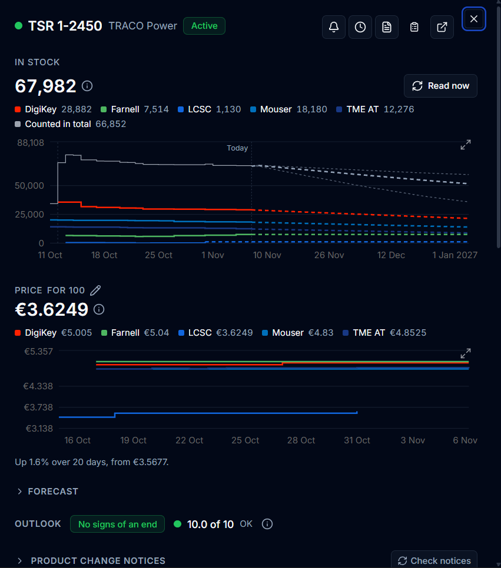

Every part Prism knows has a supply sheet. You open it from any part row in
**Supply**, from **Show part details** on a BOM line, or from **Open supply
sheet** in the header search (`⌘K`). A component's **Supply** tab in **Library
Manager** shows the same sheet for its main part, with a few component blocks
on top.

For the screens that cover many parts and projects at once, see
[Track supply](/KiCAD-Prism/use/supply/).

## On a component's Supply tab

These blocks belong to the component rather than to one part:

| Block | What it does |
| --- | --- |
| **Not for new designs** | Appears when QA has marked the component (see [Ending components](/KiCAD-Prism/use/supply/#ending-components)). **Clear mark** removes it. |
| [Parts](#parts-and-alternates) | The main part and its alternates. |
| **Stores** | What your own inventory holds: **Available**, **Held** and **At vendor**. Only available stock counts toward a build. It says **Not connected** or **Feed down** when the inventory can't be read, and **Stale** on a record whose last read failed. |
| **Watch component** | Has Prism read the part on a schedule. The watch follows the component's current part, even when its part number changes. |

### Parts and alternates

An alternate is another part the component may be built with. Once QA approves
it, its stock and offers count wherever the main part's do.

1. Under **Parts**, enter the manufacturer and part number and choose **Propose
   alternate**. It shows **Waiting for QA**.
2. QA approves or rejects it on the row, or in **Supply → Review → To
   approve**.

If the component's part number changes, its approved alternates go back to
**Waiting for QA** so they can be checked against the new main part. When BOM
lines for two components resolve to the same part, only alternates both of them
approved count. To find candidates, use [Alternatives](#alternatives).

## Actions

The icons next to the part's name:

| Icon | Opens |
| --- | --- |
| <svg xmlns="http://www.w3.org/2000/svg" width="1.1em" height="1.1em" viewBox="0 0 24 24" fill="none" stroke="currentColor" stroke-width="2" stroke-linecap="round" stroke-linejoin="round" role="img" aria-label="Alert rules for this part" style="display:inline;margin:0;vertical-align:-0.2em"><path d="M10.268 21a2 2 0 0 0 3.464 0"/><path d="M3.262 15.326A1 1 0 0 0 4 17h16a1 1 0 0 0 .74-1.673C19.41 13.956 18 12.499 18 8A6 6 0 0 0 6 8c0 4.499-1.411 5.956-2.738 7.326"/></svg> | The part's [alert rules](#alert-rules), on a watched part. |
| <svg xmlns="http://www.w3.org/2000/svg" width="1.1em" height="1.1em" viewBox="0 0 24 24" fill="none" stroke="currentColor" stroke-width="2" stroke-linecap="round" stroke-linejoin="round" role="img" aria-label="How often this part is read" style="display:inline;margin:0;vertical-align:-0.2em"><path d="M12 6v6l4 2"/><circle cx="12" cy="12" r="10"/></svg> | Its [read schedule](#read-schedule). |
| <svg xmlns="http://www.w3.org/2000/svg" width="1.1em" height="1.1em" viewBox="0 0 24 24" fill="none" stroke="currentColor" stroke-width="2" stroke-linecap="round" stroke-linejoin="round" role="img" aria-label="Datasheet" style="display:inline;margin:0;vertical-align:-0.2em"><path d="M6 22a2 2 0 0 1-2-2V4a2 2 0 0 1 2-2h8a2.4 2.4 0 0 1 1.704.706l3.588 3.588A2.4 2.4 0 0 1 20 8v12a2 2 0 0 1-2 2z"/><path d="M14 2v5a1 1 0 0 0 1 1h5"/><path d="M10 9H8"/><path d="M16 13H8"/><path d="M16 17H8"/></svg> | Its datasheet. |
| <svg xmlns="http://www.w3.org/2000/svg" width="1.1em" height="1.1em" viewBox="0 0 24 24" fill="none" stroke="currentColor" stroke-width="2" stroke-linecap="round" stroke-linejoin="round" role="img" aria-label="Work item" style="display:inline;margin:0;vertical-align:-0.2em"><rect width="8" height="4" x="8" y="2" rx="1" ry="1"/><path d="M16 4h2a2 2 0 0 1 2 2v14a2 2 0 0 1-2 2H6a2 2 0 0 1-2-2V6a2 2 0 0 1 2-2h2"/><path d="M12 11h4"/><path d="M12 16h4"/><path d="M8 11h.01"/><path d="M8 16h.01"/></svg> | A new [work item](/KiCAD-Prism/use/supply/#work-items) about the part. |

### Alert rules

The <svg xmlns="http://www.w3.org/2000/svg" width="1.1em" height="1.1em" viewBox="0 0 24 24" fill="none" stroke="currentColor" stroke-width="2" stroke-linecap="round" stroke-linejoin="round" role="img" aria-label="Alert rules for this part" style="display:inline;margin:0;vertical-align:-0.2em"><path d="M10.268 21a2 2 0 0 0 3.464 0"/><path d="M3.262 15.326A1 1 0 0 0 4 17h16a1 1 0 0 0 .74-1.673C19.41 13.956 18 12.499 18 8A6 6 0 0 0 6 8c0 4.499-1.411 5.956-2.738 7.326"/></svg> decides which alerts the part raises on
the Dashboard:

| Setting | Effect |
| --- | --- |
| **A Dashboard alert when** | One tick per kind: **Out of stock**, **At or below the threshold** (with the stock threshold next to it), **Could run out soon**, **Likely to run out everywhere**, **Price rises**, **Price over the target** and **Assessment gets worse**. Untick one to stop it. |
| **A price rise of at least (%)** | How big a rise counts. Leave it empty for the workspace default. |
| **Likely to run out at a chance of (%)** | When **Likely to run out everywhere** fires, from 50 to 99. |
| **Target price** | The unit price above which **Price over the target** fires. |

Switching an alert off is up to QA. A designer's request waits in **Supply →
Review → To approve**, and the alert keeps firing until it's approved. The
workspace defaults are in **Supply settings → Alerts**.

### Read schedule

The <svg xmlns="http://www.w3.org/2000/svg" width="1.1em" height="1.1em" viewBox="0 0 24 24" fill="none" stroke="currentColor" stroke-width="2" stroke-linecap="round" stroke-linejoin="round" role="img" aria-label="How often this part is read" style="display:inline;margin:0;vertical-align:-0.2em"><path d="M12 6v6l4 2"/><circle cx="12" cy="12" r="10"/></svg> shows how often Prism reads the part and
why: a tracked project, someone's choice or a watched component. From there you
can:

- pick a tier (daily, weekly, monthly or not tracked). Prism shows what it
  costs in distributor calls before you **Apply**;
- **Pick** one packaging at a distributor that lists several, to save calls;
- set the stock threshold and the packaging to count, or choose **Always read
  at the fastest rate**;
- **Stop tracking** or **Stop watching**, which keeps the history. **Stop
  tracking** only appears while something other than a tracked project follows
  the part.

**Queued for calls** means a distributor's daily limit has no room for the part
yet. The tiers are explained in
[How often a part is read](/KiCAD-Prism/use/supply/#how-often-a-part-is-read).

## The part's sections

Below its name and icons, the sheet shows the part's figures in these
sections, from top to bottom.

### In stock and price

These show the total stock with its history per distributor, and the price at
the part's price quantity. The quantity is 100 unless you change it with the
<svg xmlns="http://www.w3.org/2000/svg" width="1.1em" height="1.1em" viewBox="0 0 24 24" fill="none" stroke="currentColor" stroke-width="2" stroke-linecap="round" stroke-linejoin="round" role="img" aria-label="Change the price quantity" style="display:inline;margin:0;vertical-align:-0.2em"><path d="M21.174 6.812a1 1 0 0 0-3.986-3.987L3.842 16.174a2 2 0 0 0-.5.83l-1.321 4.352a.5.5 0 0 0 .623.622l4.353-1.32a2 2 0 0 0 .83-.497z"/><path d="m15 5 4 4"/></svg>. **Read now** fetches fresh figures, once every
15 minutes.

### Forecast

| Line | Tells you |
| --- | --- |
| **Can be bought** | The chance the part can be bought in four weeks, with a strip for the next twelve. |
| **Runs out** | When stock is likely to be gone. **(from similar parts)** when its own history is too short. |
| **Out everywhere within 8 weeks** | The chance that no distributor has stock. |
| **A distributor back** | When a distributor should restock. **(quoted ...)** when the date comes from its lead time. |
| **In 90 days** | The likely price range. |

A greyed line marked **Learning** or **Paused** hasn't proven reliable yet, and is
never used for alerts. See
[Forecasts](/KiCAD-Prism/use/supply-figures/#forecasts).

### Outlook

The outlook tells you whether the part is heading for its end (**Ended**,
**Ending**, **Warning signs**, **No signs of an end** or **Not enough to say**) and
gives its health score. The band is based on evidence, and doesn't predict how
many years the part has left; see
[When a part may end](/KiCAD-Prism/use/supply-figures/#when-a-part-may-end).

Hover <svg xmlns="http://www.w3.org/2000/svg" width="1.1em" height="1.1em" viewBox="0 0 24 24" fill="none" stroke="currentColor" stroke-width="2" stroke-linecap="round" stroke-linejoin="round" role="img" aria-label="Show what the outlook and the health rest on" style="display:inline;margin:0;vertical-align:-0.2em"><circle cx="12" cy="12" r="10"/><path d="M12 16v-4"/><path d="M12 8h.01"/></svg> to see the signals,
the five scores (lifecycle, sourcing, inventory, market, compliance) and the
findings behind them.

#### Waive a finding

If you accept a finding, such as a known single source, choose **Waive** on it
and give a reason. A QA waiver applies at once; a designer's waits for QA and
can be withdrawn until then. QA can **Revoke** any waiver. If the condition
behind a waiver changes, the waiver stops applying and you can **Waive again**.

### Product change notices

This lists the end-of-life, last-time-buy, NRND and product-change notices for
the part, with where each came from. An open notice raises a **Change notice**
alert. Designers and administrators can:

- **Check notices** to ask the distributors for new notices on this part;
- **Add notice** to enter one by hand, with its number, what it announces, a
  link and the last time buy and ship dates.

:::note
Only DigiKey provides change notices, and only once an administrator has signed
in at DigiKey on its connector (see
[DigiKey change notices](/KiCAD-Prism/admin/supply/#digikey-change-notices)).
DigiKey allows 50 notice calls a day, separate from stock and price calls, and
you can check a part once an hour.
:::

### Listings

Each distributor has a block, preferred first, with the SKU, stock, price,
minimum order, lead time, what is on order and, if the last read failed, why.

| Tag | Means |
| --- | --- |
| **Followed** | The listing that counts when a distributor has several. |
| **Not counted** | Not matched to this part (a different number or maker). |
| **Marketplace**, **Assembly stock** | A third-party seller. Never counts. |
| **Discontinued here** | This distributor has dropped the part. |
| **Test data** | From the Simulated market, a made-up distributor for demos. |

| To | Use |
| --- | --- |
| Prefer a distributor | The <svg xmlns="http://www.w3.org/2000/svg" width="1.1em" height="1.1em" viewBox="0 0 24 24" fill="none" stroke="currentColor" stroke-width="2" stroke-linecap="round" stroke-linejoin="round" role="img" aria-label="Prefer this distributor" style="display:inline;margin:0;vertical-align:-0.2em"><path d="M11.525 2.295a.53.53 0 0 1 .95 0l2.31 4.679a2.123 2.123 0 0 0 1.595 1.16l5.166.756a.53.53 0 0 1 .294.904l-3.736 3.638a2.123 2.123 0 0 0-.611 1.878l.882 5.14a.53.53 0 0 1-.771.56l-4.618-2.428a2.122 2.122 0 0 0-1.973 0L6.396 21.01a.53.53 0 0 1-.77-.56l.881-5.139a2.122 2.122 0 0 0-.611-1.879L2.16 9.795a.53.53 0 0 1 .294-.906l5.165-.755a2.122 2.122 0 0 0 1.597-1.16z"/></svg> next to its name. |
| Count another listing | The <svg xmlns="http://www.w3.org/2000/svg" width="1.1em" height="1.1em" viewBox="0 0 24 24" fill="none" stroke="currentColor" stroke-width="2" stroke-linecap="round" stroke-linejoin="round" role="img" aria-label="Follow this instead" style="display:inline;margin:0;vertical-align:-0.2em"><path d="M2.062 12.348a1 1 0 0 1 0-.696 10.75 10.75 0 0 1 19.876 0 1 1 0 0 1 0 .696 10.75 10.75 0 0 1-19.876 0"/><circle cx="12" cy="12" r="3"/></svg> on that listing. |
| Read one packaging per distributor | **One per distributor**. |
| Confirm a near match (QA) | **This is the same part**. |
| Price a quantity | The <svg xmlns="http://www.w3.org/2000/svg" width="1.1em" height="1.1em" viewBox="0 0 24 24" fill="none" stroke="currentColor" stroke-width="2" stroke-linecap="round" stroke-linejoin="round" role="img" aria-label="Try a quantity" style="display:inline;margin:0;vertical-align:-0.2em"><rect width="16" height="20" x="4" y="2" rx="2"/><line x1="8" x2="16" y1="6" y2="6"/><line x1="16" x2="16" y1="14" y2="18"/><path d="M16 10h.01"/><path d="M12 10h.01"/><path d="M8 10h.01"/><path d="M12 14h.01"/><path d="M8 14h.01"/><path d="M12 18h.01"/><path d="M8 18h.01"/></svg> next to the title. Nothing is saved. |

What counts toward stock is explained in
[Stock](/KiCAD-Prism/use/supply-figures/#stock).

### Alternatives

**Find alternatives** lists parts Prism already knows with the same value,
graded by their ratings: **Ratings met**, **Similar · N ratings unknown**, **Same
value, other package** and **Fails a rating**. With a DigiKey connector, **Ask
DigiKey for substitutes** adds DigiKey's own suggestions.

A grade is not an approval. Prism doesn't compare footprints or pins, so check
those before you propose the part under [Parts](#parts-and-alternates).

### Compliance

This shows RoHS and REACH, each with a badge such as **Compliant**, **Not
compliant**, **Affected**, **Disputed** or **Unknown**, along with what each
distributor states, the declared substances and the RoHS exemptions. An unknown
state is never shown as clear.

Designers and administrators can:

- **Declare** a substance by its CAS number. Prism flags it if it's on the
  REACH Candidate List. A substance a distributor stated can't be removed.
- Name a RoHS exemption, such as `7(a)`.
- Set the export control class with the <svg xmlns="http://www.w3.org/2000/svg" width="1.1em" height="1.1em" viewBox="0 0 24 24" fill="none" stroke="currentColor" stroke-width="2" stroke-linecap="round" stroke-linejoin="round" role="img" aria-label="Set export control" style="display:inline;margin:0;vertical-align:-0.2em"><path d="M20 13c0 5-3.5 7.5-7.66 8.95a1 1 0 0 1-.67-.01C7.5 20.5 4 18 4 13V6a1 1 0 0 1 1-1c2 0 4.5-1.2 6.24-2.72a1.17 1.17 0 0 1 1.52 0C14.51 3.81 17 5 19 5a1 1 0 0 1 1 1z"/><path d="m9 12 2 2 4-4"/></svg>: **Export
  controlled** with a class (ECCN), or **Not controlled**. Otherwise Prism uses
  what distributors state, and shows **ECCN disputed** when they differ. **Use
  what distributors say** drops a class you set.

All of it goes into the project's **Costing** download.

:::note
The Candidate List check needs an administrator to load the list in **Supply
settings → Reference data**. Until then the section says **REACH Candidate List
not loaded**.
:::

## Find components by supply in the catalog

The catalog's **Supply** column shows each component's status, stock, price and
store stock. Filter by **Tracked**, **At risk** or **In local stock**, then
choose **Track these** (or **Track N shown**) to track every component on
screen. Designers and administrators can also ctrl-click rows (cmd-click on a
Mac) and choose **Track N picked**. You pick daily, weekly or monthly, and the
dialog shows each distributor's daily call limit before it starts.
