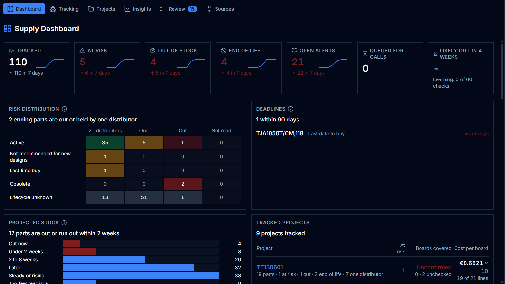
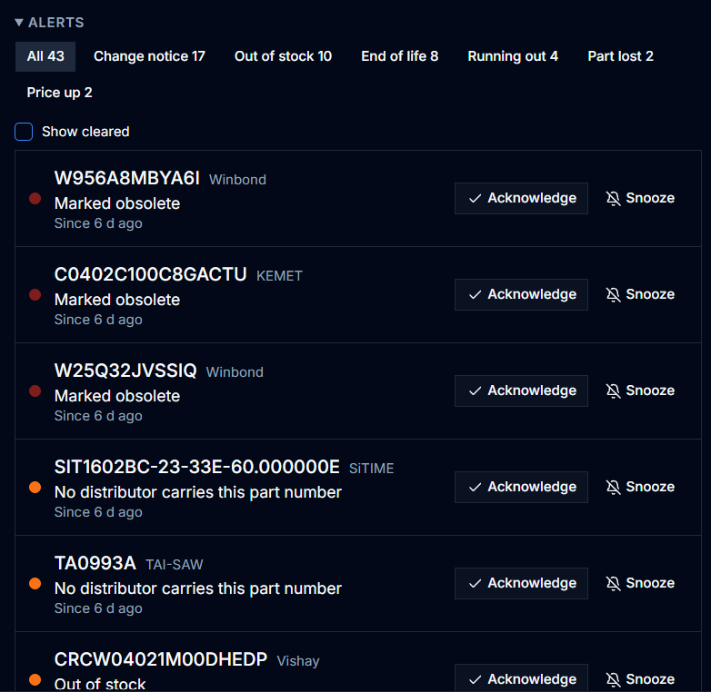
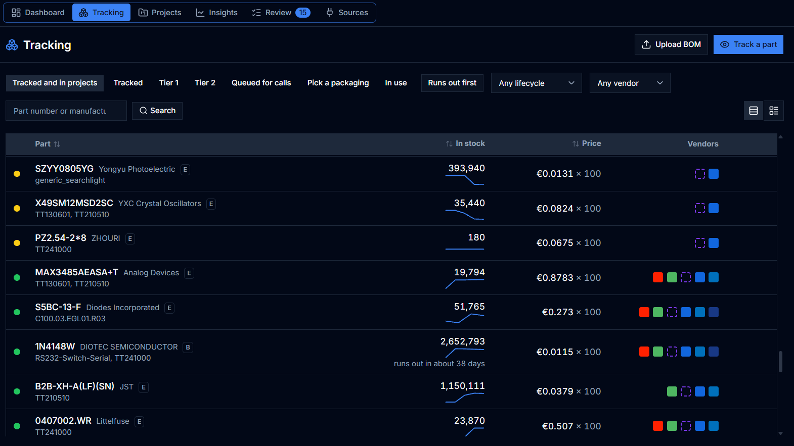
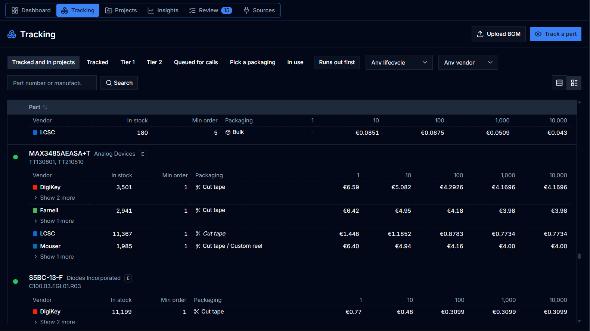
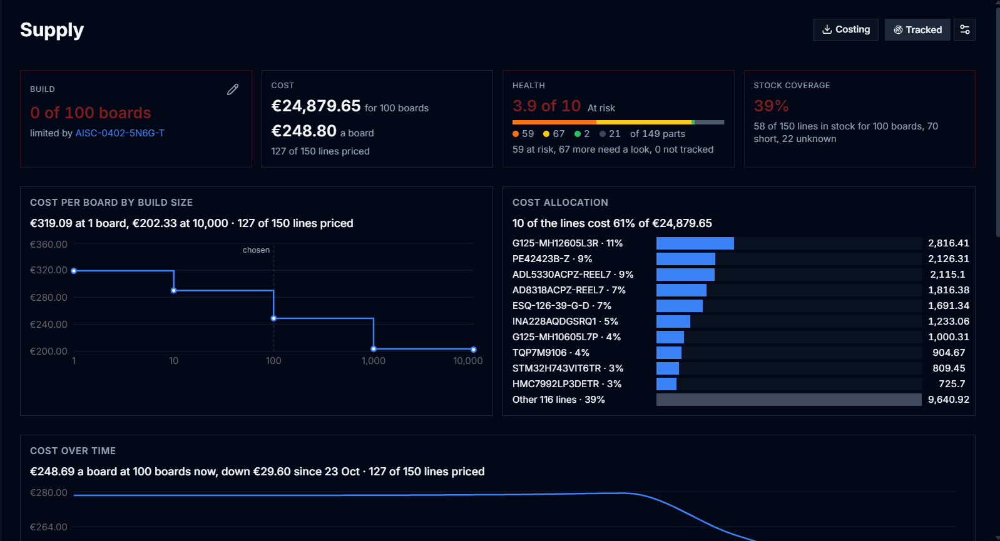
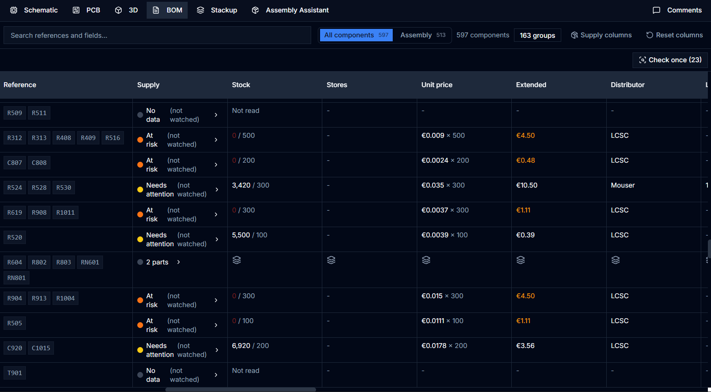
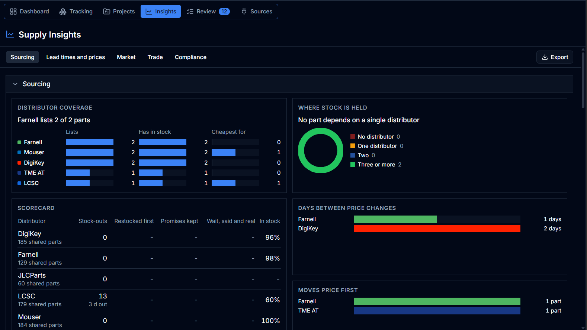
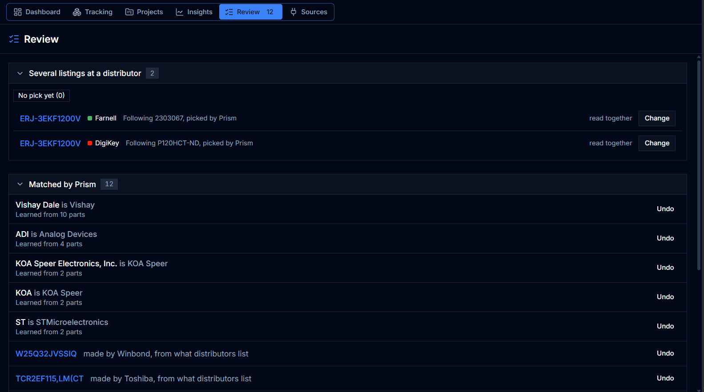

:::note
Supply shows nothing until an administrator has set up its sources. See
[Connect distributors and inventory](/KiCAD-Prism/admin/supply/).
:::

Prism reads stock, prices and lifecycle for your library components' parts from
distributors and your own inventory, and keeps the history. It warns you
before a part runs out and tells you whether a project can be built. It never
buys anything.

Supply follows the components in the
[Component Database](/KiCAD-Prism/use/library-manager/). You can look up any
part number, but to track one it has to belong to a component first.

This page covers the **Supply** area and a project's supply. For a single part
and a component's **Supply** tab, see
[Supply for a part](/KiCAD-Prism/use/supply-components/). There are
step-by-step guides in [Supply workflows](/KiCAD-Prism/use/supply-workflows/),
and the rules behind every figure in
[How supply figures are worked out](/KiCAD-Prism/use/supply-figures/).

## Supply roles

| Role | In Supply |
| --- | --- |
| **Viewer** | Supply is hidden. |
| **Designer** | Reads everything. Tracks projects, parts and components; picks packaging and distributors; sets a part's alert rules, price quantity and export control; edits compliance; opens work items; reads a part now. Proposes alternates and waivers, acknowledges and snoozes alerts, and asks QA to dismiss an ending part or switch an alert off. |
| **QA** | What a designer does, except proposing alternates, acknowledging or snoozing alerts, ctrl-click picking in the catalog and editing compliance. Approves alternates, waivers, dismissals, maker spellings and listings; switches alerts off; links or ignores unmatched local stock; accepts, rejects or reopens work items; decides on ending components (retiring only where the catalog workflow lets QA archive). |
| **Admin** | Everything, plus connectors, inventory sources and **Supply settings**. |

## Supply UI

| Place | What it is for |
| --- | --- |
| [Dashboard](#dashboard) | What needs a person today. |
| [Tracking](#tracking) | Every part Prism follows, and BOM files to check. |
| [Projects](#projects) | Every project that uses a known part. |
| [Insights](#insights) | Trends across all your parts. |
| [Review](#review) | What Prism couldn't settle alone, and work items. |
| [Sources](#sources) | Connectors, inventory and **Supply settings**. |
| [A part's supply sheet](/KiCAD-Prism/use/supply-components/) | One part. Every part row above opens it. |
| [A component's Supply tab](/KiCAD-Prism/use/supply-components/#on-a-components-supply-tab) | The same sheet, plus alternates and local stock. |
| [A project's Supply tab](#check-whether-a-project-can-be-built) | Whether it can be built, and what it costs. |
| [The BOM tab](#supply-columns-in-the-bom) | **Supply columns** on each BOM line. |
| [Release Studio](#supply-in-release-studio) | Supply recorded with each release. |

## Dashboard

The Dashboard is where to start the day. Every tile and cell opens the parts
behind it. **Likely out in 4 weeks** appears once the forecast has a track
record, and deadlines turn red within 90 days. Figures from the Simulated
market, a made-up distributor for demos, carry a **Test data** chip.

If a connector or the stores feed can't be read, the figures may be stale;
**Supply → Sources** shows which one.

### Ending components

This list holds components whose part, or an approved alternate, is ending and
that nobody has decided about yet. QA or an administrator decides on the row:

| Decision | Effect |
| --- | --- |
| **Not for new designs** | The component stays usable but is marked on its **Supply** tab and in the catalog. **Clear mark** removes it. |
| **Retire** | The component is archived and leaves the KiCad library. Offered only when no other approved part is healthy. |
| **Dismiss** | Hidden until the part gets a new reason. A designer can **Ask QA to dismiss**. |

Retiring breaks symbols already placed, so propose an alternate or a
replacement first. QA can't archive a released component; an administrator
has to.

If the decision needs work first, the <svg xmlns="http://www.w3.org/2000/svg" width="1.1em" height="1.1em" viewBox="0 0 24 24" fill="none" stroke="currentColor" stroke-width="2" stroke-linecap="round" stroke-linejoin="round" role="img" aria-label="Work item" style="display:inline;margin:0;vertical-align:-0.2em"><rect width="8" height="4" x="8" y="2" rx="1" ry="1"/><path d="M16 4h2a2 2 0 0 1 2 2v14a2 2 0 0 1-2 2H6a2 2 0 0 1-2-2V6a2 2 0 0 1 2-2h2"/><path d="M12 11h4"/><path d="M12 16h4"/><path d="M8 11h.01"/><path d="M8 16h.01"/></svg> on the row opens a
[work item](#work-items).

### Alerts

A watched part raises an alert when it runs out or falls to its threshold,
could run out, rises in price or passes its target price, gets a change notice,
is dropped by every distributor, starts ending, or gets worse. Designers and
administrators can **Acknowledge** or **Snooze** an alert, and it clears by
itself once the condition ends. **Show cleared** brings back past ones.

You choose what a part alerts on with the <svg xmlns="http://www.w3.org/2000/svg" width="1.1em" height="1.1em" viewBox="0 0 24 24" fill="none" stroke="currentColor" stroke-width="2" stroke-linecap="round" stroke-linejoin="round" role="img" aria-label="Alert rules for this part" style="display:inline;margin:0;vertical-align:-0.2em"><path d="M10.268 21a2 2 0 0 0 3.464 0"/><path d="M3.262 15.326A1 1 0 0 0 4 17h16a1 1 0 0 0 .74-1.673C19.41 13.956 18 12.499 18 8A6 6 0 0 0 6 8c0 4.499-1.411 5.956-2.738 7.326"/></svg> on
its sheet (see [Alert rules](/KiCAD-Prism/use/supply-components/#alert-rules)).
The exact conditions are in [Alerts](/KiCAD-Prism/use/supply-figures/#alerts).
Alerts stay in Prism: no email or chat message is sent.

## Tracking

**Supply → Tracking** lists every part Prism follows. The chips narrow it to a
tier, to parts **Queued for calls** or waiting for a packaging pick, or to parts
in use, and you can filter by lifecycle and distributor. Sort by **Runs out
first** to see what you'll need to buy soonest.

The list opens in the compact layout <svg xmlns="http://www.w3.org/2000/svg" width="1.1em" height="1.1em" viewBox="0 0 24 24" fill="none" stroke="currentColor" stroke-width="2" stroke-linecap="round" stroke-linejoin="round" role="img" aria-label="Compact" style="display:inline;margin:0;vertical-align:-0.2em"><rect width="18" height="18" x="3" y="3" rx="2"/><path d="M21 9H3"/><path d="M21 15H3"/></svg>. Switch to the detailed layout
<svg xmlns="http://www.w3.org/2000/svg" width="1.1em" height="1.1em" viewBox="0 0 24 24" fill="none" stroke="currentColor" stroke-width="2" stroke-linecap="round" stroke-linejoin="round" role="img" aria-label="Detailed, a row for each vendor" style="display:inline;margin:0;vertical-align:-0.2em"><rect width="7" height="7" x="3" y="3" rx="1"/><rect width="7" height="7" x="3" y="14" rx="1"/><path d="M14 4h7"/><path d="M14 9h7"/><path d="M14 15h7"/><path d="M14 20h7"/></svg> to see each distributor's stock, minimum order, packaging and price
breaks under every part, without opening its sheet.

### How often a part is read

Tier 1 parts are read daily, tier 2 weekly or monthly, and anything else only
when someone opens it. A part takes the highest tier any reason gives it. The
<svg xmlns="http://www.w3.org/2000/svg" width="1.1em" height="1.1em" viewBox="0 0 24 24" fill="none" stroke="currentColor" stroke-width="2" stroke-linecap="round" stroke-linejoin="round" role="img" aria-label="How often this part is read" style="display:inline;margin:0;vertical-align:-0.2em"><path d="M12 6v6l4 2"/><circle cx="12" cy="12" r="10"/></svg> on its sheet shows why, and lets you change
it (see [Read schedule](/KiCAD-Prism/use/supply-components/#read-schedule)).

| To follow | Do this |
| --- | --- |
| A project | On its **Supply** tab, choose **Track this project** and pick the designs, distributors, packaging, usual build and spares. A bar shows each distributor's daily call limit. New BOM revisions are picked up within 15 minutes: added parts are tracked at tier 1, and removed ones stop unless something else follows them. |
| One part | **Supply → Tracking → Track a part**. The number has to belong to a library component. |
| A component | **Watch component** on its **Supply** tab. It follows the component's current part; if you stop watching, the part drops to whatever else follows it. |
| Many components | **Track these** in the [catalog](/KiCAD-Prism/use/supply-components/#find-components-by-supply-in-the-catalog). |

**Read now** on a part's sheet fetches fresh figures, once every 15 minutes.

:::note
Each distributor allows only so many calls a day. Parts that don't fit wait as
**Queued for calls**, and a Dashboard tile counts them. To save calls, pick one
packaging per distributor with **Pick** in a part's
<svg xmlns="http://www.w3.org/2000/svg" width="1.1em" height="1.1em" viewBox="0 0 24 24" fill="none" stroke="currentColor" stroke-width="2" stroke-linecap="round" stroke-linejoin="round" role="img" aria-label="How often this part is read" style="display:inline;margin:0;vertical-align:-0.2em"><path d="M12 6v6l4 2"/><circle cx="12" cy="12" r="10"/></svg>, or in **Supply → Review → Several listings
at a distributor**. An administrator can also raise a connector's budget.
:::

### Check a BOM file that isn't a project

**Upload BOM** checks an XLSX or CSV, such as a customer's BOM or a quote,
without saving it. Map the manufacturer part number (or LCSC number) and
quantity columns, set how many boards to build, and choose **Check N distinct
parts**.

:::note
Files are limited to 2 MB. The check uses figures Prism already holds and makes
no distributor calls, so a part Prism doesn't read yet comes back without stock
or price.
:::

## Projects

**Supply → Projects** lists every project that uses a known part, tracked ones
first. Each row sums up the project's cost per board, the boards it can build
and its open alerts. Open a row to see its parts, or use the
<svg xmlns="http://www.w3.org/2000/svg" width="1.1em" height="1.1em" viewBox="0 0 24 24" fill="none" stroke="currentColor" stroke-width="2" stroke-linecap="round" stroke-linejoin="round" role="img" aria-label="Open the project's supply" style="display:inline;margin:0;vertical-align:-0.2em"><path d="M15 3h6v6"/><path d="M10 14 21 3"/><path d="M18 13v6a2 2 0 0 1-2 2H5a2 2 0 0 1-2-2V8a2 2 0 0 1 2-2h6"/></svg> to go to the project's **Supply** tab. If the
list is empty, designers and administrators can choose **Read project BOMs** to
have Prism read the projects nobody has opened yet.

### Check whether a project can be built

A project's **Supply** tab shows how many boards you can build, what they cost
and which parts are in the way. It works on the usual build, or 100 boards if
there is none; pick a variant from the menu if the project has several. Use the
<svg xmlns="http://www.w3.org/2000/svg" width="1.1em" height="1.1em" viewBox="0 0 24 24" fill="none" stroke="currentColor" stroke-width="2" stroke-linecap="round" stroke-linejoin="round" role="img" aria-label="Change the number of boards" style="display:inline;margin:0;vertical-align:-0.2em"><path d="M21.174 6.812a1 1 0 0 0-3.986-3.987L3.842 16.174a2 2 0 0 0-.5.83l-1.321 4.352a.5.5 0 0 0 .623.622l4.353-1.32a2 2 0 0 0 .83-.497z"/><path d="m15 5 4 4"/></svg> on **Build** to try another quantity. On a tracked project you can keep it
as the usual build, and the Dashboard, the cost history and the next release
snapshot will use it.

| Tile | Shows |
| --- | --- |
| **Build** | Boards the stock covers and the line that limits it. **Unconfirmed** while some lines can't be checked. |
| **Cost** | Cost of the build and of one board, including what minimum orders leave over. |
| **Health** | The BOM's health score and its parts by status. |
| **Stock coverage** | Share of BOM lines in stock for the build. |

Below the tiles you'll find cost by build size, the lines that cost the most,
cost over time, releases and the parts. Chips such as **Short for this build**
and **Limiting the build** narrow the list. Some lines carry a marker:

| Marker | Means |
| --- | --- |
| **+N alt** | Approved alternates add their stock and offers to the line. |
| **Not in library** | No component has this part. **Add to Component Database** fixes it. |
| **No MPN** | A fitted part with no part number. |
| **N to settle** | You need to choose the part or its maker. |
| **Out of date** | The latest read failed. Click it to read again. |

**Costing** downloads CSVs for the build size shown: the full costing with each
line's distributor and SKU, one file per distributor to turn into a quote
request or cart, a draft RoHS and REACH declaration, and the export and tariff
codes. Prices are list prices without VAT or shipping. An administrator sets
the currency, price quantity, spares and preferred distributors in
[Supply settings](/KiCAD-Prism/admin/supply/#supply-settings); a tracked
project can use its own spares.

The tab reads the BOM on the default branch, not a checked-out commit. Your own
stock counts only when it is available, not held or at a vendor. The rules are
in [Can the project be built](/KiCAD-Prism/use/supply-figures/#can-the-project-be-built)
and [What it costs](/KiCAD-Prism/use/supply-figures/#what-it-costs).

### Supply columns in the BOM

A project's **BOM** tab adds supply columns to the latest revision: supply
status, stock, stores, unit price, extended price, distributor and lead time.
Prices are for the usual build if the project is tracked, otherwise for one
board. The distributor column shows where the price comes from, which isn't
necessarily the vendor in your BOM. Turn on **Supply columns** to hide the rest.

Lines are matched by the symbol's Prism ID when it has one, otherwise by
manufacturer and part number. **Show part details** opens the part's sheet, and
the same row lets you watch the part or add it to the library. **Check once**
reads parts nobody tracks a single time, without tracking them; lines that
still need a part or maker chosen are skipped. The columns cover the first
2,000 parts of a BOM.

### Supply in Release Studio

At the outputs stage, Release Studio shows the supply health of the BOM the
release exported, for the usual build. It's there to inform, and never blocks a
release. When you publish, you can attach the compliance draft, and Prism keeps
a record of what supply said. The project's **Supply** tab then lists each release
with its health and a **Compliance CSV**. **Since then** names the parts that got
worse after it, for releases recorded at the build size shown.

The check uses the parts the release shipped with, even if a component has
since moved to another part. If Prism has never read the project's BOM, the
publish step offers **Keep this BOM in Prism**, which stores it without asking
any distributor or tracking anything.

## Insights

**Supply → Insights** looks across every tracked part. Each section appears
once it has data, and every bar opens the parts behind it.

| Section | Answers |
| --- | --- |
| **Sourcing** | Who stocks your parts, who is cheapest, and how many parts rely on one distributor. |
| **Lead times** and **prices** | The longest lead times and the biggest price moves of the last 30 days. |
| **Stock risk** | Parts that will run out before an order placed today would arrive. |
| **Market** | Out-of-stock, ending and lead-time trends by maker and category. |
| **Forecasts** | Lead times, shortages and prices ahead, once forecasts have a track record. |
| **Trade** and **Compliance** | Origin, export control and RoHS/REACH across your parts. |

**Export** downloads every tracked part with its risk figures as a CSV.

## Review

Review collects what Prism couldn't settle on its own. Go through it every
week: an unsettled spelling or listing means a part's stock isn't counted.

| List | What is waiting | Who decides |
| --- | --- | --- |
| **Needs a choice** | Part numbers several makers use. | Anyone who tracks parts |
| **To approve** | Alternates, waivers, dismissals and alerts to switch off. A proposer can withdraw a waiver while it waits. | QA |
| **Pinned under another number**, **Manufacturer spellings**, **Listings waiting** | Distributor listings and maker names to confirm. | QA |
| **Several listings at a distributor** | Which packaging to read. | Anyone who tracks parts |
| **Matched by Prism** | Matches Prism made on its own. Keep one with **Accept**, all of them with **Accept all**, or undo a wrong one. | QA |
| **Work items** | Open decisions (see [Work items](#work-items)). | QA |
| **Unmatched local stock** | Inventory stock no component matches. **Link** it to a component (**Link anyway** when neither MPN nor SAP code agrees), **Add** a component, or **Ignore** it, for consumables. **Restore** brings an ignored part back. | QA |

### Work items

A work item records a decision before anyone acts on it: the proposed action
(investigate, find an alternate, not for new designs, retire, replace, last
time buy), an owner, the evidence and a date to look again. It also keeps the
projects that used the part at the time.

Open one with the <svg xmlns="http://www.w3.org/2000/svg" width="1.1em" height="1.1em" viewBox="0 0 24 24" fill="none" stroke="currentColor" stroke-width="2" stroke-linecap="round" stroke-linejoin="round" role="img" aria-label="Work item" style="display:inline;margin:0;vertical-align:-0.2em"><rect width="8" height="4" x="8" y="2" rx="1" ry="1"/><path d="M16 4h2a2 2 0 0 1 2 2v14a2 2 0 0 1-2 2H6a2 2 0 0 1-2-2V6a2 2 0 0 1 2-2h2"/><path d="M12 11h4"/><path d="M12 16h4"/><path d="M8 11h.01"/><path d="M8 16h.01"/></svg> on a part's sheet or on an ending
component's row. **Supply → Review → Work items** lists them as **Open**, **Mine**,
**Due** (the recheck date has come), **Done** and **Rejected**. Anyone in Supply can
open items and add notes. QA and administrators accept, reject or reopen them,
and the owner, whoever opened it or QA can mark one done.

A work item doesn't change anything by itself: you still retire or mark a
component on the Dashboard.

## Sources

**Supply → Sources** shows the connectors, inventory servers and **Supply
settings**. Everyone can see them, but only administrators change them. See
[Connect distributors and inventory](/KiCAD-Prism/admin/supply/).

## Ask an assistant

An assistant connected over [MCP](/KiCAD-Prism/automate/mcp/) can read supply,
look for alternatives, watch a component and ask for a fresh read. Approving
alternates and waivers stays with people.
